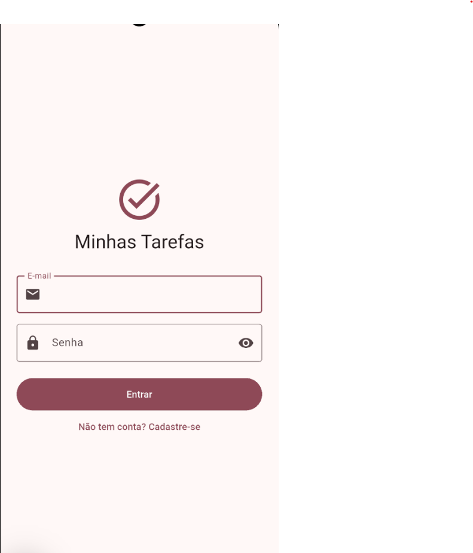
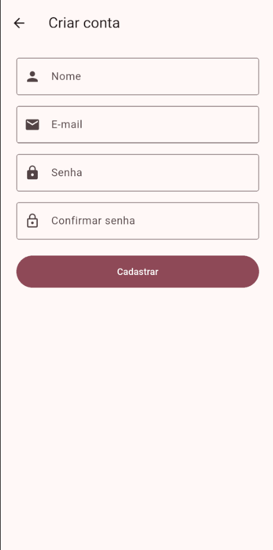
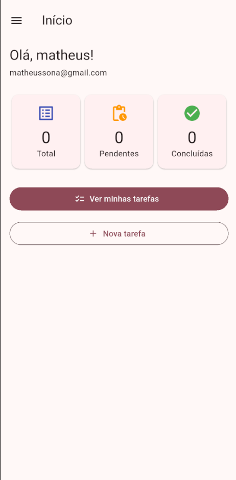
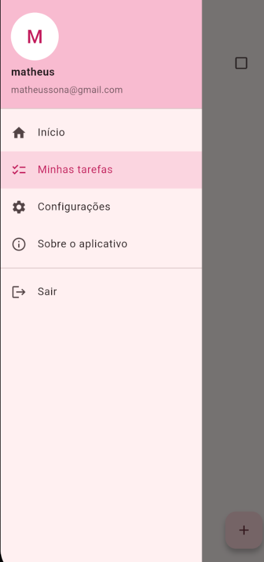
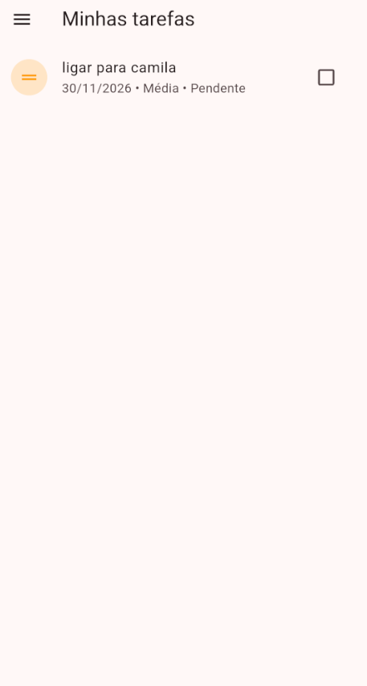
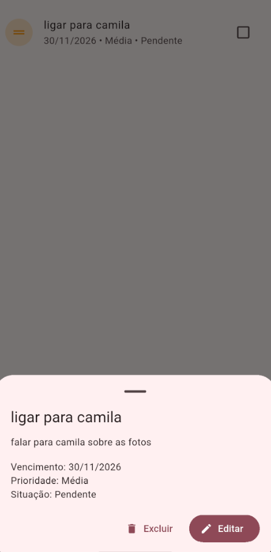
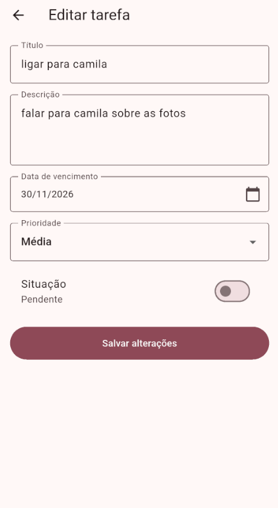
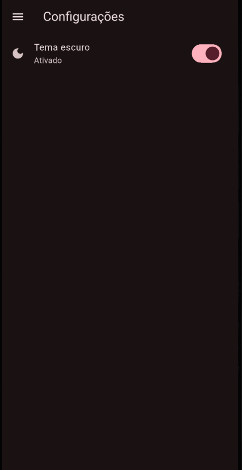

# Minhas Tarefas – Prova da P2 Programação Mobile
# Aluna: Samara Sona Fernandes

Aplicativo Flutter de gerenciamento de tarefas com Firebase Authentication (e-mail/senha),
Firebase Realtime Database, SharedPreferences (tema) e Drawer.

## Pré-requisitos
- Flutter SDK 3.22+ e Dart 3.3+
- Conta Google / projeto no [Firebase Console](https://console.firebase.google.com)
- Node.js + Firebase CLI: `npm i -g firebase-tools`
- FlutterFire CLI: `dart pub global activate flutterfire_cli`

## Configuração
1. Dentro desta pasta, gere as pastas de plataforma (sem sobrescrever o `lib/`):
   ```
   flutter create . --org com.example --project-name p2_tarefas
   ```
2. No Firebase Console crie um projeto e ative:
   - **Authentication → Sign-in method → E-mail/senha**
   - **Realtime Database → Criar banco de dados** (modo bloqueado)
3. Cole as regras do arquivo `database.rules.json` em *Realtime Database → Regras* e publique.
   (Garantem que cada usuário só lê/grava `/tarefas/{seu uid}`.)
4. Conecte o app ao projeto (substitui `lib/firebase_options.dart`):
   ```
   firebase login
   flutterfire configure
   ```
5. Instale as dependências e execute:
   ```
   flutter pub get
   flutter run
   ```
> Android: se houver erro de minSdk, defina `minSdk = 23` em `android/app/build.gradle(.kts)`.

## Estrutura do banco
```
usuarios/{uid}          -> { uid, nome, email }
tarefas/{uid}/{id}      -> { titulo, descricao, dataVencimento, prioridade, concluida }
```

## Organização
`models/` (Usuario, Tarefa) · `services/` (auth, firebase, preferences) ·
`screens/` · `widgets/drawer_menu.dart` · `themes/app_theme.dart`

## Capturas de tela do app

### Login


### Cadastro de novo usuário


### Tela inicial


### Menu lateral


### Cadastro de nova tarefa


### Listagem das tarefas


### Gerenciar tarefas


### Editar tarefas


### Tema escuro



